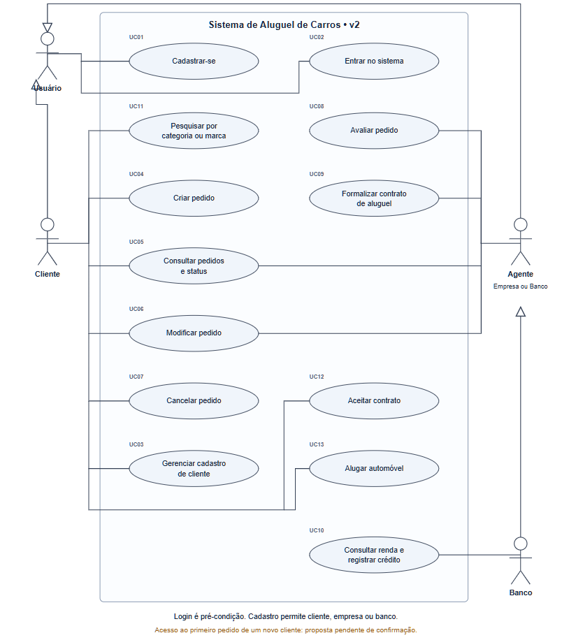
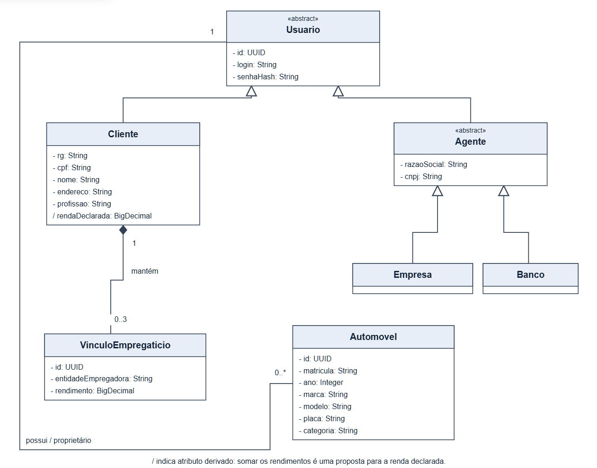
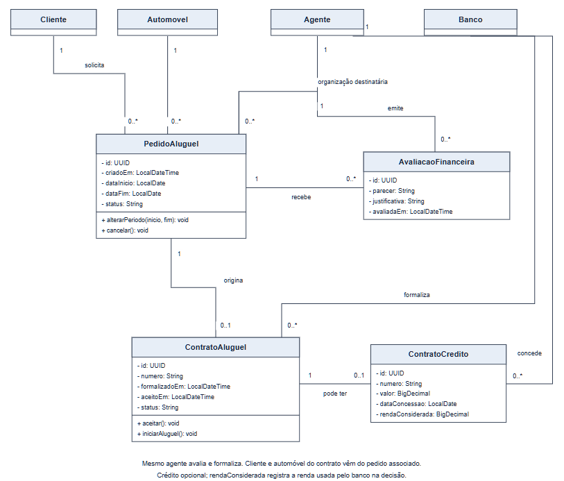
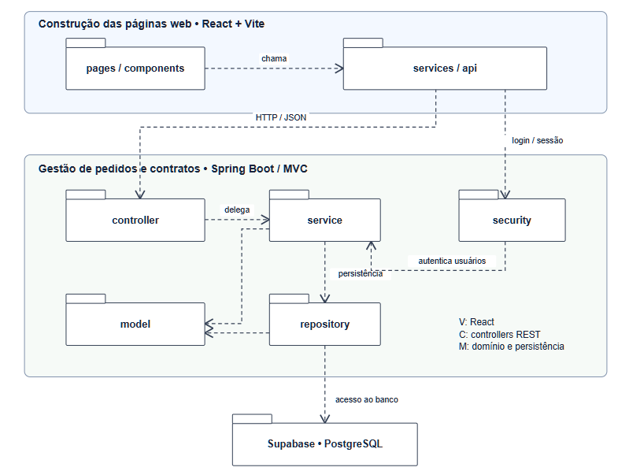

# 🏷️ AlugaCar 👨‍💻

<table>
  <tr>
    <td><strong>Encontre um carro e acompanhe seu pedido até a ativação do aluguel.</strong><br>
    Sistema web desenvolvido no Laboratório 02 de Desenvolvimento e Integração de Aplicações Web (DIAW), do curso de Engenharia de Software da PUC Minas.</td>
    <td></td>
  </tr>
</table>

## 🚧 Status do Projeto


[](https://github.com/abneralmeidacord/DIAW-AlugaCar/actions/workflows/validacao.yml)


## 📚 Índice

- [Status do Projeto](#-status-do-projeto)
- [Links Úteis](#-links-úteis)
- [Sobre o Projeto](#-sobre-o-projeto)
- [Funcionalidades Principais](#-funcionalidades-principais)
- [Tecnologias Utilizadas](#-tecnologias-utilizadas)
- [Arquitetura](#-arquitetura)
- [Instalação e Execução](#-instalação-e-execução)
  - [Pré-requisitos](#pré-requisitos)
  - [Variáveis de Ambiente](#-variáveis-de-ambiente)
  - [Instalação de Dependências](#-instalação-de-dependências)
  - [Inicialização do Banco de Dados](#-inicialização-do-banco-de-dados-postgresql)
  - [Como Executar a Aplicação](#-como-executar-a-aplicação)
- [Deploy](#-deploy)
- [Estrutura de Pastas](#-estrutura-de-pastas)
- [Demonstração](#-demonstração)
- [Testes](#-testes)
- [Documentações utilizadas](#-documentações-utilizadas)
- [Autores](#-autores)
- [Contribuição](#-contribuição)
- [Agradecimentos](#-agradecimentos)
- [Licença](#-licença)

## 🔗 Links Úteis

- [Documentação do back-end, API e regras de negócio](backend/README.md)
- [Guia de apresentação do front-end](frontend/APRESENTACAO.md)
- [Histórias de usuário](docs/05-historias-do-usuario.md)
- [Modelagem da implementação v3](docs/06-modelos-implementacao-v3.md)
- [Registro de validação e limitações da entrega](docs/07-validacao-backend.md)

## 📝 Sobre o Projeto

O AlugaCar reúne, em uma aplicação web, a busca de veículos, a análise do pedido e a formalização do aluguel. O cliente escolhe o carro e o período, a locadora avalia o pedido e, quando há solicitação de crédito, o banco vinculado registra a concessão. O projeto usa dados fictícios para demonstrar a integração entre esses perfis.

## ✨ Funcionalidades Principais

| Área     | Funcionalidades                                                                                                                         |
| -------- | --------------------------------------------------------------------------------------------------------------------------------------- |
| Conta    | Cadastro, login, atualização de perfil e gerenciamento de até três vínculos empregatícios para clientes.                                |
| Catálogo | Busca por modelo ou marca, filtros por categoria e localidade, ordenação por diária e favoritos.                                        |
| Cliente  | Criação e acompanhamento de pedidos, alteração do período ou cancelamento antes da avaliação, aceite do contrato e ativação do aluguel. |
| Locadora | Cadastro de veículos pela API, avaliação dos pedidos da própria organização e formalização dos contratos.                               |
| Banco    | Consulta da renda declarada nos pedidos vinculados e registro da concessão de crédito.                                                  |

## 🛠 Tecnologias Utilizadas

| Camada              | Tecnologias                                                                                  |
| ------------------- | -------------------------------------------------------------------------------------------- |
| Front-end           | JavaScript, React 19, Vite 8, CSS por página e componente, Motion.                           |
| Back-end            | Java 25, Spring Boot 4.0.9, Spring MVC, Spring Security, Spring Data JPA, Hibernate e Maven. |
| Banco de dados      | PostgreSQL no Supabase e H2 para execução local e testes.                                    |
| Integração contínua | GitHub Actions para testes e build do front-end.                                             |

## 🏗 Arquitetura

O front-end React consome a API REST do Spring MVC. Os controllers recebem requisições e delegam as regras aos services, que acessam o banco via JPA. Os DTOs em `model` definem os dados trocados com a interface. A autenticação usa sessão no servidor, cookie HttpOnly, senhas com BCrypt e proteção CSRF nas operações de escrita.

### Diagramas

|                                                    Casos de uso                                                    |                              Classes                               |
| :----------------------------------------------------------------------------------------------------------------: | :----------------------------------------------------------------: |
|                    [](docs/01-casos-uso.png)                     | [](docs/02-classes.png) |
|                                              **Pedidos e contratos**                                               |                            **Pacotes**                             |
| [](docs/03-classes-pedidos-contratos.png) | [](docs/04-pacotes.png) |

Os diagramas registram a modelagem inicial. As diferenças da versão implementada estão descritas na [modelagem v3](docs/06-modelos-implementacao-v3.md).

## 🔧 Instalação e Execução

### Pré-requisitos

- Git.
- JDK 25 com `JAVA_HOME` configurado e Maven 3.9.
- Node.js 22.12 ou superior com npm. O GitHub Actions usa Node.js 24.
- Projeto Supabase, caso queira usar PostgreSQL. O perfil `local` cria um banco H2 em `backend/data/`.

### 🔑 Variáveis de Ambiente

Para usar o Supabase, copie [`backend/.env.example`](backend/.env.example) para `backend/.env`. Preencha as credenciais do PostgreSQL fornecidas em **Connect → Session pooler**, na porta 5432.

| Variável                  | Uso                                                                                                 |
| ------------------------- | --------------------------------------------------------------------------------------------------- |
| `SUPABASE_DB_URL`         | URL JDBC do PostgreSQL com `sslmode=require`.                                                       |
| `SUPABASE_DB_USER`        | Usuário PostgreSQL do Session pooler.                                                               |
| `SUPABASE_DB_PASSWORD`    | Senha do banco.                                                                                     |
| `PORT`                    | Porta da API. O padrão é `8080`.                                                                    |
| `FRONTEND_ORIGIN`         | Origens permitidas. O padrão local é `http://localhost:5173`.                                       |
| `COOKIE_SECURE`           | Use `true` em HTTPS. O padrão local é `false`.                                                      |
| `DB_INIT_MODE`            | `never` usa o esquema aplicado manualmente. `always` executa o SQL na inicialização com PostgreSQL. |
| `APP_SEED_DEMO`           | Use `true` no perfil padrão de um ambiente de testes para criar contas e veículos fictícios.        |
| `APP_ALLOW_FIRST_CONTACT` | Controla o acesso da organização ao primeiro pedido de um cliente. O padrão é `true`.               |

No front-end, [`frontend/.env.example`](frontend/.env.example) documenta `VITE_API_URL`. O valor padrão `/api` usa o proxy do Vite para encaminhar as chamadas ao back-end em `localhost:8080`. As credenciais do banco pertencem ao ambiente do back-end.

### 📦 Instalação de Dependências

```powershell
git clone https://github.com/abneralmeidacord/DIAW-AlugaCar.git
cd DIAW-AlugaCar
cd frontend
npm ci
cd ..
```

O Maven resolve as dependências do back-end ao iniciar a aplicação ou executar os testes.

### 💾 Inicialização do Banco de Dados (PostgreSQL)

1. No SQL Editor do Supabase, execute [`schema.sql`](backend/src/main/resources/db/migration/schema.sql).
2. Preencha `backend/.env` com as credenciais do banco.
3. Para popular uma base de demonstração com empresas, bancos e veículos, execute [`supabase.sql`](backend/src/main/resources/db/seed/supabase.sql) depois de criar o esquema. A conta de cliente da demonstração é criada pela carga em Java, ativada com `APP_SEED_DEMO=true`.

### ⚡ Como Executar a Aplicação

Em um terminal, a partir da raiz do projeto, inicie a API com H2.

```powershell
cd backend
mvn spring-boot:run "-Dspring-boot.run.profiles=local"
```

O perfil local inicia com o banco vazio na primeira execução. Para usar o Supabase já configurado, execute `mvn spring-boot:run` em `backend/` com o perfil padrão.

Em outro terminal, também a partir da raiz do projeto, inicie o front-end.

```powershell
cd frontend
npm run dev
```

Abra [http://localhost:5173](http://localhost:5173). A API atende em [http://localhost:8080/api/health](http://localhost:8080/api/health).

## 🚀 Deploy

Execute `npm run build` em `frontend/` para gerar os arquivos estáticos em `frontend/dist/` e `mvn clean package` em `backend/` para gerar `backend/target/alugacar-1.0.0.jar`.

Em `backend/`, inicie o servidor com `java -jar target/alugacar-1.0.0.jar`. Sirva os arquivos estáticos e encaminhe `/api` ao Spring Boot por um proxy reverso sob o mesmo domínio. Configure o PostgreSQL no ambiente do back-end e habilite `COOKIE_SECURE=true` em HTTPS. Consulte as [instruções do back-end](backend/README.md#executar-com-supabase).

## 📂 Estrutura de Pastas

| Caminho                                                                            | Conteúdo                                                                            |
| ---------------------------------------------------------------------------------- | ----------------------------------------------------------------------------------- |
| [`frontend/src/`](frontend/src/)                                                   | Interface React organizada em `pages`, `components`, `styles`, `services` e `data`. |
| [`frontend/public/`](frontend/public/)                                             | Imagens e outros arquivos estáticos.                                                |
| [`frontend/tests/`](frontend/tests/)                                               | Testes do cliente HTTP e das regras da interface.                                   |
| [`backend/src/main/java/br/com/alugacar/`](backend/src/main/java/br/com/alugacar/) | Controllers, services, entidades, DTOs e tratamento de erros.                       |
| [`backend/src/main/resources/`](backend/src/main/resources/)                       | Configurações Spring e scripts SQL.                                                 |
| [`backend/src/test/`](backend/src/test/)                                           | Testes de modelo e de integração da API.                                            |
| [`docs/`](docs/)                                                                   | Diagramas, histórias de usuário e documentação de validação.                        |
| [`.github/workflows/`](.github/workflows/)                                         | Pipeline de validação.                                                              |

## 🎥 Demonstração

### 🌐 Aplicação Web

Para iniciar o H2 com contas e veículos fictícios, use o comando abaixo em `backend/` no lugar do comando local padrão.

```powershell
mvn spring-boot:run "-Dspring-boot.run.profiles=local" "-Dspring-boot.run.arguments=--app.seed-demo=true"
```

As três contas abaixo usam a senha fictícia `demo123`.

| Perfil                      | E-mail                  |
| --------------------------- | ----------------------- |
| Cliente                     | `cliente@alugacar.demo` |
| Empresa (Aurora Mobilidade) | `empresa@alugacar.demo` |
| Banco (Banco Horizonte)     | `banco@alugacar.demo`   |

1. Na página inicial, clique em **Explorar demo** e entre como **Cliente**. Abra um veículo da Aurora Mobilidade e envie o pedido. Para demonstrar crédito, escolha Banco Horizonte no formulário.
2. Entre como **Empresa**, registre um parecer favorável e formalize o contrato.
3. Volte ao perfil **Cliente**, aceite o contrato e clique em **Alugar agora** para ativá-lo.
4. Se solicitou crédito, entre como **Banco** para registrar a concessão após a formalização do contrato.

Veja o [roteiro completo de apresentação](frontend/APRESENTACAO.md#apresentar-o-fluxo).

### 💻 Exemplo de chamada da API

```powershell
curl.exe http://localhost:8080/api/health
```

A resposta contém `"status": "UP"` e `"application": "AlugaCar"`.

## 🧪 Testes

| Local       | Comando         | Cobertura                                                                         |
| ----------- | --------------- | --------------------------------------------------------------------------------- |
| `backend/`  | `mvn test`      | Regras do domínio e fluxos HTTP, incluindo autenticação, autorização e contratos. |
| `frontend/` | `npm test`      | Cliente HTTP, CSRF, tratamento de erros e permissões da interface.                |
| `frontend/` | `npm run build` | Compilação da interface e geração da versão portátil.                             |

O [workflow de validação](.github/workflows/validacao.yml) executa os testes do back-end com H2 e PostgreSQL 17, além dos testes e do build do front-end.

## 🔗 Documentações utilizadas

- [Spring Boot](https://docs.spring.io/spring-boot/index.html) e [Spring Security](https://docs.spring.io/spring-security/reference/index.html)
- [React](https://react.dev/), [Vite](https://vite.dev/guide/) e [Motion para React](https://motion.dev/docs/react)
- [PostgreSQL](https://www.postgresql.org/docs/) e [conexão ao PostgreSQL pelo Supabase](https://supabase.com/docs/guides/database/connecting-to-postgres)

## 👥 Autores

| Nome                      | GitHub                                                   | Portfólio                                                   |
| ------------------------- | -------------------------------------------------------- | ----------------------------------------------------------- |
| Abner Cordeiro de Almeida | [@abneralmeidacord](https://github.com/abneralmeidacord) | [Abner Almeida](https://abneralmeida-portfolio.vercel.app/) |

## 🤝 Contribuição

1. Faça um fork e crie uma branch para sua mudança.
2. Execute os testes da parte alterada e registre a mudança em um commit.
3. Abra um pull request com a descrição da alteração e os passos para validá-la.

## 🙏 Agradecimentos

À PUC Minas pelo contexto acadêmico do projeto e ao Prof. Dr. João Paulo Aramuni pelo [template de README da disciplina](https://github.com/joaopauloaramuni/desenvolvimento-e-integracao-de-aplicacoes-web/blob/main/TEMPLATES/template_README.md).

## 📄 Licença

O repositório ainda não declara uma licença. Os créditos das imagens estão em [`creditos.html`](frontend/public/images/creditos.html).
