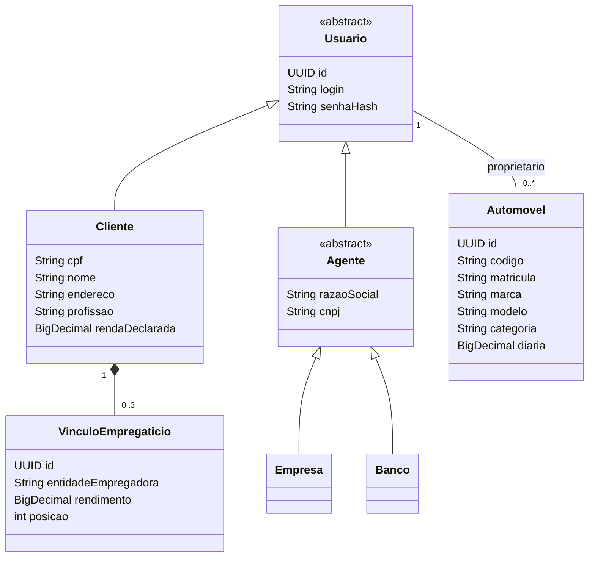
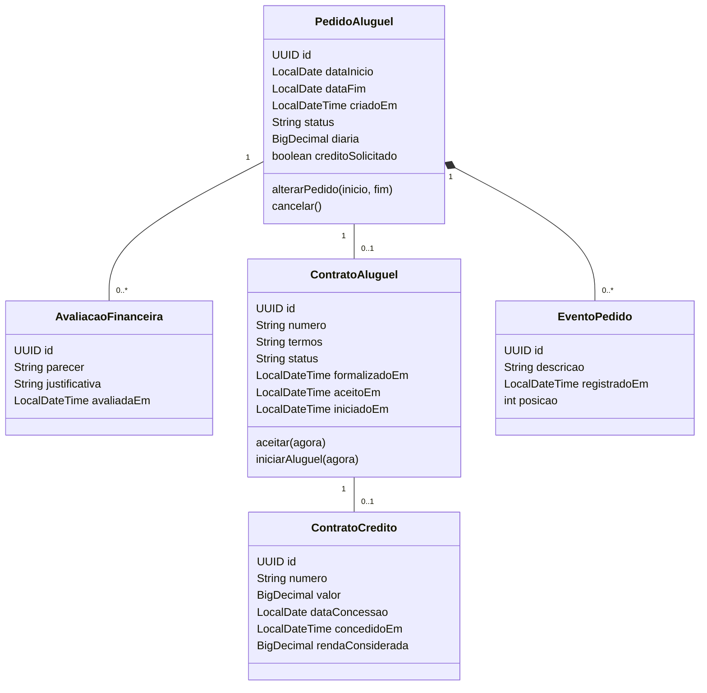
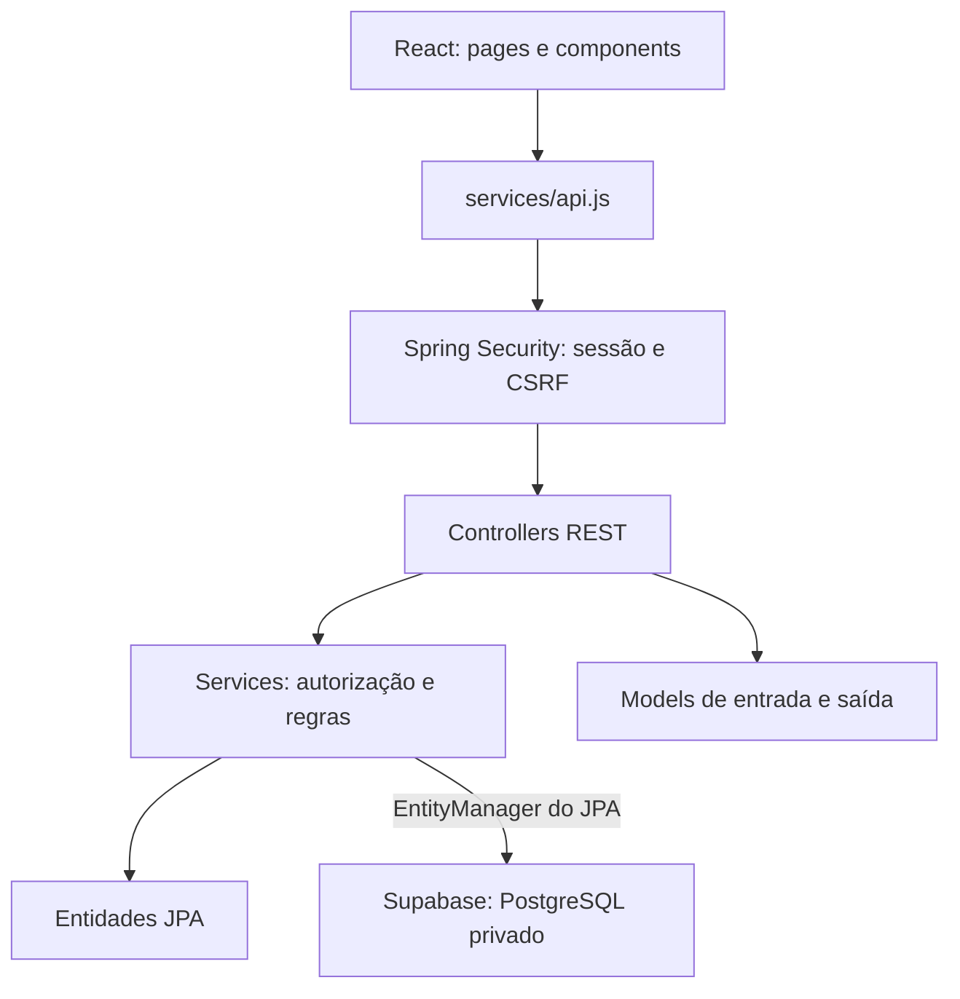

# Modelagem de implementação — v3

04/11/2026. Os PNGs v2 permanecem preservados. Esta versão registra os ajustes usados no código; propostas de negócio continuam sujeitas à confirmação.

## Usuários, organização e renda

Herança JPA usa tabelas separadas (`JOINED`). A renda é calculada a partir dos vínculos. `posicao` preserva a ordem dos vínculos. Automovel também possui ano, placa, combustível, cor, foto e destaque. A diária é usada para calcular o valor do período.

## Pedidos e contratos

Cada pedido também referencia um Cliente, um Automovel e o Agente destinatário. AvaliacaoFinanceira e ContratoAluguel referenciam o agente responsável; ContratoCredito referencia o Banco concedente. Se houver solicitação de crédito, PedidoAluguel guarda o Banco escolhido antes da existência do contrato. Esse vínculo autoriza a consulta pelo banco e não equivale à concessão.

Diária no pedido é uma cópia do valor na data da solicitação; mudanças futuras na frota não alteram o pedido existente. Termos, início e eventos foram acrescentados para atender às telas e registrar o fluxo. A associação permite várias avaliações, mas a aplicação limita a uma até que reavaliações e divergências sejam definidas. Um crédito por aluguel continua hipótese do modelo e está protegido por unicidade no banco.

## Arquitetura MVC implementada

O pacote `model` define as entradas e respostas HTTP. O pacote `entity` representa as tabelas e seus relacionamentos. O frontend atua como View e os controllers encaminham as chamadas aos services, que verificam as regras de titularidade e organização.

Autenticação usa Spring Security, BCrypt e sessão HttpOnly; os dados da sessão não precisam de uma entidade de domínio. Favoritos permanecem uma preferência local do navegador; usuários, renda, pedidos, avaliações e contratos passam pela API. Fotografias ilustrativas da Home podem aparecer antes do login; a pesquisa operacional da frota exige autenticação.

As pendências das HU03, HU04, HU05, HU06, HU07 e HU10 estão discriminadas em `backend/README.md`; esta versão não as transforma em requisitos confirmados.
